# FitPortal

FitPortal is the customer-facing component of **Dynamic Fit**, a system for creating packing orders, optimising how items are packed into boxes, and visualising the result.

> **Live Application:** [Dynamic Fit](https://dynamicfit.aaron-d02.workers.dev/)
>
> **Local Development:** [Getting Started](docs/local-development.md)

## Product Overview

| Name | Role |
|---|---|
| **Dynamic Fit** | The integrated project: Portal, Solver and Visualiser in one application |
| **FitPortal** | The customer-facing Portal: order management, Box Inventory, users and the API *(this repository)* |
| **FitSolver** | The packing optimisation engine, used by the Portal as a Python package |
| **FitVisualiser** | The 3D packing visualisation, a separate frontend application |

FitPortal lets staff create orders from items, optimise how the items pack into the available box types, review the result and finalise the order. Finalising consumes box stock. Access is controlled by role.

### Repository Purpose

| Repository | Purpose |
|---|---|
| **This repository** (`comp4050-portal`) | Standalone FitPortal. Used to develop, test and maintain the Portal frontend and backend locally, including the database and Solver integration. It is not the primary repository for deploying the complete application. |
| [**Dynamic Fit monorepo**](https://github.com/Wasif-ZA/dynamic-fit) | Integrates FitPortal, FitSolver and FitVisualiser. This is the source for the complete application deployment. |

## Key Features

- Order creation, editing and management, with Active, On hold and Archive views.
- Item entry by form or JSON import, with character and weight validation.
- Box Inventory management, including reviewed `boxes.json` import and optional quantity limits.
- Packing optimisation through FitSolver, including re-optimisation.
- Packing results, including box summaries, rejected items and 3D visualisation through FitVisualiser.
- Supabase Auth sign-in and role-based permissions (User, Supervisor, Administrator).
- Order finalisation, which deducts the boxes used from Box Inventory.
- Advisory manual handling warnings for heavy packed boxes.
- Automatic archiving of finalised orders one month after finalisation.

## Requirements

FitPortal's requirements cover order management, box inventory, packing optimisation, user access and integration with FitSolver and FitVisualiser.

See the [Requirements Specification](docs/requirements.md) for the complete requirements, including MVP and post-MVP functionality.

## System Architecture



The React frontend only talks to the FastAPI backend and Supabase Auth. FastAPI owns all application state, verifies each bearer token, and runs FitSolver in-process. FitVisualiser is a separate application that fetches a solution through a short-lived, order-scoped URL.

For implementation details, see the [Architecture Documentation](docs/architecture.md).

## Technology Stack

| Layer | Technology | Responsibility |
|---|---|---|
| Frontend | React 18, React Router | User interface and client-side routing |
| | Vite, Tailwind CSS | Build tooling and styling |
| | Vitest | Frontend unit tests |
| Backend | Python, FastAPI | REST API, request handling, business rules |
| | Pydantic | Request and response validation |
| | SQLAlchemy, psycopg | Persistence layer |
| Persistence | PostgreSQL (Supabase) | Orders, items, Box Inventory, users, solutions |
| Authentication | Supabase Auth | Email and password identity, access tokens |
| Integrations | FitSolver | Packing optimisation, installed as a Python package |
| | FitVisualiser | 3D visualisation, a separate application |

## Team Contributors and Roles

| Contributor | Role | GitHub |
|---|---|---|
| Aaron Minhas | Scrum Master, Developer | [@AaronMinhas](https://github.com/AaronMinhas) |
| Ahmad Arja | Product Owner, Tester | [@Ahmad-Arja](https://github.com/Ahmad-Arja) |
| Amer Alam | Developer, Tester | [@AmerAlam7](https://github.com/AmerAlam7) |
| Mohammad Nazimuddin | Developer, Tester | [@Mohammad123nazimuddin](https://github.com/Mohammad123nazimuddin) |


## Repository Structure

```text
comp4050-portal/
├── backend/     FastAPI application, tests and account bootstrap script
├── frontend/    React application and frontend tests
├── supabase/    Local Supabase configuration and SQL migrations (authoritative schema)
├── docs/        Architecture, API, user guide, local development, testing, diagram source
└── README.md
```

## Getting Started

FitPortal runs locally against a Docker-hosted Supabase stack. The setup covers the Python environment, local Supabase, environment files, the first accounts, and starting the backend and frontend.

See [Local Development](docs/local-development.md).

The standalone setup does not include FitVisualiser, so the 3D view and the complete Portal, Solver and Visualiser workflow are available only through the [Dynamic Fit monorepo](https://github.com/Wasif-ZA/dynamic-fit).

## How to Use

1. Sign in with a Portal account.
2. Create an order and add items by form or JSON import.
3. Submit the order for optimisation. Supervisors and Administrators can run optimisation directly.
4. Review the packing result and open the 3D view.
5. Edit and re-optimise if items were rejected, then finalise the order.

See the [User Guide](docs/user-guide.md).

## Documentation

| Document | Contents |
|---|---|
| [Requirements](docs/requirements.md) | Functional and non-functional requirements |
| [Local Development](docs/local-development.md) | Prerequisites, setup, environment variables, running the stack |
| [Architecture](docs/architecture.md) | Components, data flows, authentication, transactions, integrations |
| [Database](docs/database.md) | Schema, sequences, Box Inventory quantities |
| [User Guide](docs/user-guide.md) | Workflows and role differences |
| [API](docs/api.md) | Routes, access rules and order lifecycle behaviour |
| [Testing](docs/testing.md) | Backend and frontend test suites |

## Development Workflow

Work is tracked in GitHub Issues which are linked to the [DPP Scrum Board](https://github.com/users/AaronMinhas/projects/3), a GitHub Projects task board. Work is planned in sprints.

1. Select an issue from the current sprint and assign it.
2. Create a branch for the issue.
3. Implement and test the change.
4. Open a pull request targeting `main` and link it to the issue.
5. Have another team member review and approve it.
6. Squash merge into `main`.

Direct changes to `main` are restricted. Issue and pull request templates are in [`.github/`](.github/).
