# Architecture

This document describes the current FitPortal architecture. The schema and Box Inventory rules are in [Database](database.md); routes are in [API](api.md).


The editable diagram source is [`diagrams/fitportal-architecture.html`](diagrams/fitportal-architecture.html).

## Components

| Component | Responsibility |
|---|---|
| React frontend (`frontend/`) | User interface. Signs in with Supabase Auth and calls the Portal API with a bearer token |
| FastAPI backend (`backend/`) | The only trusted writer. Validates requests, authorises users, applies business rules and persists state |
| PostgreSQL (Supabase) | Orders, items, Box Inventory, Portal users and saved solutions |
| Supabase Auth | Email and password identity and access tokens |
| FitSolver | Packing optimisation, imported as a Python package and run in the backend process |
| FitVisualiser | 3D visualisation, a separate frontend application outside this repository |

The frontend never reads or writes the database directly, and no database credentials reach the browser. It holds only the Supabase publishable key.

## Backend Layers

```text
React
    ↓
FastAPI routes
    ↓
domain modules (store, boxes, finalisation)
    ↓
repositories
    ↓
SQLAlchemy + psycopg
    ↓
PostgreSQL (Supabase)
```

| Layer | Location | Responsibility |
|---|---|---|
| Routes | `backend/app/routes/` | HTTP handling, role dependencies, mapping domain errors to HTTP status codes |
| Models | `backend/app/models.py` | Pydantic request and response models and validation |
| Domain modules (business rules) | `store.py`, `boxes.py`, `finalisation.py`, `inventory.py`, `item_weights.py`, `user_management.py` | Business rules and transaction boundaries |
| Repositories (database access) | `backend/app/repositories/` | All SQL. Convert between database rows and Pydantic models |
| Persistence models | `backend/app/db/models.py`, `database.py` | SQLAlchemy models, engine and session lifecycle |
| Solver adapter | `solver_adapter.py` | Converts a Portal order and box types into the FitSolver request format |

Routes and domain code never contain SQL. Repositories convert between database rows and Pydantic models, so the API schema and the database schema stay independent. PostgreSQL columns are `snake_case`; the API contract uses PascalCase field names.

### Request handling and validation

Pydantic models validate request bodies before route code runs, so malformed input is rejected with `422`. They enforce positive dimensions and weights, item quantities of at least 1, and the item field limits below. Domain rules that need database state, such as the per-item weight limit and order state checks, run in the domain modules and are returned as `422` or `409`.

`ItemCode` is limited to 32 characters and `ItemReference` to 100. Both require non-blank text, and surrounding whitespace is trimmed before the limits are checked and the value is saved. Values are never truncated. Unicode code points count as characters, consistently in the frontend and backend.

### Sessions and transactions

Each domain operation runs in `session_scope()`, which commits on success and rolls back on any exception. An order write that spans several tables is therefore one transaction.

Operations that change an existing order first lock its row with `SELECT ... FOR UPDATE`, then check state. Concurrent requests for the same order are serialised, so stale state cannot be acted on.

## Authentication and Authorisation

1. React signs in with Supabase email and password Auth and receives an access token.
2. The frontend sends the token to FastAPI as `Authorization: Bearer <token>`.
3. FastAPI verifies the signature, issuer, audience and expiry (against the Supabase JWKS, or a shared secret for HS256 tokens) and requires an end-user (`authenticated`) token.
4. FastAPI maps the Auth user ID to a row in `portal_users` and applies the Portal role and account status from the database.

Token metadata cannot grant Portal permissions. A disabled account is rejected even while its Supabase session remains cryptographically valid. An identity with no Portal account receives `403`.

Roles are `USER`, `SUPERVISOR` and `ADMINISTRATOR`. Route access is declared with dependencies in `backend/app/auth.py`:

| Capability | User | Supervisor | Administrator |
|---|---|---|---|
| Create, edit and view orders; submit for optimisation; read inventory and results | Yes | Yes | Yes |
| Run and re-optimise; finalise; hold, resume, archive and delete orders | No | Yes | Yes |
| Manage Box Inventory and handling warning settings | No | Yes | Yes |
| Manage `USER` accounts | No | Yes | Yes |
| Manage `SUPERVISOR` accounts | No | No | Yes |

Account rules are enforced in `user_management.py`. Administrator accounts are created only through the bootstrap script, an Administrator cannot modify another Administrator, and the backend rejects any change that would leave no active Administrator.

Row Level Security is not the application authorisation layer. The backend connects with its own database credential and owns all policy checks. A migration enables RLS on the Portal tables and revokes privileges from the Supabase `anon` and `authenticated` roles, so the Supabase REST interface cannot reach application data.

The backend creates and manages Portal accounts through the Supabase Auth admin API, using `SUPABASE_SECRET_KEY`, which never leaves the backend.

## Order Lifecycle



Source: [`diagrams/order-lifecycle.html`](diagrams/order-lifecycle.html).

| From | Action | To | Who |
|---|---|---|---|
| `DRAFT` | Submit | `AWAITING_OPTIMISATION` | Any signed-in user |
| `DRAFT`, `AWAITING_OPTIMISATION`, `OPTIMISED` | Optimise (re-optimise when `OPTIMISED`) | `OPTIMISED` | Supervisor, Administrator |
| `OPTIMISED` | Finalise (no rejected items) | `FINAL` | Supervisor, Administrator |
| `AWAITING_OPTIMISATION`, `OPTIMISED` | Edit items | `DRAFT` | Any signed-in user |

- Editing an unfinished order replaces its items, returns it to `DRAFT` and discards its saved solution in one transaction.
- `Hold` is recorded separately (`HeldAt`), so status, items and results are preserved. A held order cannot be edited, submitted, optimised or finalised until resumed.
- `FINAL` orders are read-only. `ArchivedAt` moves them to the Archive view.
- A rejected indicator is derived from the saved solution. The stored status stays `OPTIMISED`.

Behaviour for each route is described in [API](api.md#order-lifecycle).

## Order and Inventory Persistence

- An order and its items are written in one transaction. Items keep an explicit `position`.
- A successful optimisation saves the solution and marks the order `OPTIMISED` in one transaction. A failed optimisation leaves the previous state unchanged.
- The solver runs without a database lock. Before saving, the backend locks the order and re-checks its state and items. A result is discarded if the items changed, or the order was held, archived or deleted, while the solver ran.
- Finalisation locks the order, requires `OPTIMISED` with no rejected items, locks the required `box_types` rows, checks that stock covers the solution, deducts stock and sets `FINAL` with `FinalisedAt`, all in one transaction. Concurrent finalisations cannot oversubscribe Box Inventory.
- Hold, resume, archive and deletion never change box stock. Deletion removes only that order's items and saved solution through foreign keys.
- Deleting a box type does not affect saved solutions, which store box references as text. An optimised order whose solution uses a deleted box type cannot be finalised until it is re-optimised or the box type is restored.
- The backend archives finalised orders one calendar month after `FinalisedAt`. It checks once at startup, to catch up after downtime, and then every minute, independently of any browser session. A failed check is logged and retried on the next sweep.

## FitSolver Integration

FitSolver is a Python package imported by `routes/solve.py` (`fitsolver.engine.solve`). It runs inside the backend process. It is not a separate HTTP service, server or container.

1. `POST /orders/{id}/solve` loads the order and the active, available box types.
2. Item weights are validated against the box capacity.
3. `solver_adapter.py` converts the order and boxes to the Solver request format (millimetres and grams; `BoxGroup` is passed as the item's group).
4. FitSolver returns a solution document, which the backend saves as JSONB and returns.

The standalone repository installs FitSolver from the Dynamic Fit monorepo through `backend/requirements-standalone.txt`. Within the monorepo it is the local `packages/solver` package.

## FitVisualiser Integration

FitVisualiser is a separate application and cannot attach the Portal bearer token when it fetches a URL. The Portal uses a scoped handoff instead:



Source: [`diagrams/visualiser-handoff.html`](diagrams/visualiser-handoff.html).

1. The frontend calls `POST /orders/{id}/visualizer-handoff` with the user's bearer token.
2. The backend signs a short-lived token (HS256, `VISUALIZER_TOKEN_SECRET`) bound to the order ID and a digest of the saved solution, and returns a solution URL containing it.
3. The frontend embeds FitVisualiser at `VITE_VISUALISER_BASE`, passing the solution URL.
4. FitVisualiser fetches `GET /orders/{id}/solution/visualizer?token=...`. The backend verifies the token, order and digest, then returns the saved solution.

The token expires after 300 seconds by default (`VISUALIZER_TOKEN_TTL_SECONDS`). It grants read access to one order's current solution only. If the solution changes, the digest no longer matches. The Supabase access token is never placed in a URL, and the normal solution and summary endpoints remain protected.

## Frontend Structure

| Path | Contents |
|---|---|
| `src/pages/` | Routed pages: login, orders list, create, edit, order summary, Box Inventory, user management |
| `src/components/` | Layout, order, box and shared UI components |
| `src/api/client.js` | Portal API client. Attaches the bearer token |
| `src/auth/supabase.js` | Supabase client using the publishable key |
| `src/context/AppContext.jsx` | Session, identity and shared settings |
| `src/lib/` | Validation, role checks and display helpers, with unit tests |

Role checks in the frontend (`src/lib/roles.js`) only decide which controls are shown. The backend enforces every permission.

## Boundaries

| Boundary | Rule |
|---|---|
| Browser to backend | HTTP REST with a Supabase bearer token. The only supported data path |
| Backend to database | The backend's own connection. No other component connects |
| Backend to FitSolver | In-process function call |
| Backend to Supabase Auth | JWKS or secret for verification; admin API for account management |
| FitVisualiser to backend | One read-only request, authorised by a scoped, short-lived token |
