# Database

The authoritative schema is the SQL in [`supabase/migrations/`](../supabase/migrations/). The SQLAlchemy models in `backend/app/db/models.py` map onto it. For how the backend uses the database, see [Architecture](architecture.md).

PostgreSQL columns are `snake_case`. The API contract uses PascalCase field names, and repositories convert between the two.

## Tables

Source: [`diagrams/database-tables.html`](diagrams/database-tables.html). Only key columns are shown; the SQL migrations are authoritative.

| Table | Contents |
|---|---|
| `orders` | `OrderId`, `Reference`, lifecycle `Status`, `HeldAt`, `FinalisedAt`, `ArchivedAt`, `CreatedAt` |
| `order_items` | Each order's items, with an explicit `position` |
| `box_types` | Deployment-wide Box Inventory |
| `solutions` | The one active FitSolver document per order, stored as JSONB |
| `portal_users` | Supabase identity mapping, authoritative Portal role and status |
| `manual_handling_settings` | A single row holding the optional manual handling warning threshold (kg) |

Foreign keys cascade from `orders` to `order_items` and `solutions`, so deleting an order removes only its own items and saved solution.

`order_id_sequence` and `order_reference_sequence` generate `ORD-001` and `MQ-001` style identifiers. PostgreSQL sequences are not rolled back by a failed transaction, so gaps such as `MQ-001`, `MQ-003` are expected and accepted. Uniqueness and concurrency safety matter more than gapless numbering.

Order IDs and references are generated by the Portal API. Clients cannot supply them.

## Access

The Portal tables have Row Level Security enabled and all privileges revoked from the Supabase `anon` and `authenticated` roles (`20260913090000_close_postgrest_application_access.sql`). Only the backend's own database credential can read or write them. See [Architecture](architecture.md#authentication-and-authorisation).

## Migrations

| Migration | Change |
|---|---|
| `20260909045409_initial_portal_schema` | Orders, items, Box Inventory and solutions |
| `20260909090000_add_portal_users` | Portal users and roles |
| `20260913090000_close_postgrest_application_access` | RLS and privilege revocation |
| `20260915090000_optional_maximum_boxes_and_relax_item_codes` | Optional box quantity limit; relaxed item code rules |
| `20260915120000_remove_item_hazardous` | Removed the item hazard flag; `BoxGroup` is the grouping mechanism |
| `20261020090000_add_order_archiving` | Adds `archived_at`, `held_at` and `finalised_at` to `orders` |
| `20261020110000_dynamic_item_weight_limits` | Replaces the fixed item weight constraint with a positive-weight check; the limit is applied by the backend from available boxes |
| `20261020120000_manual_handling_settings` | Adds the `manual_handling_settings` table |

Existing finalised orders without a known completion timestamp start their one-month retention period at migration time. Their creation date is not used as a substitute for completion.

To reapply migrations locally, see [Local Development](local-development.md#resetting-local-supabase).

## Box Inventory Quantities

`MaximumBoxes` is the quantity of a box type available to use, as defined by the client's box schema:

| `MaximumBoxes` | Meaning |
|---|---|
| Omitted or `null` | No quantity limit |
| `0` | None available |
| Positive number | That many available |

A box type is offered to the Solver when it is active and has either no limit or a quantity above 0. Finalising an order subtracts the boxes the solution uses from a set quantity. Boxes with no limit are never changed.

### Import rules

Importing `boxes.json` never asks for extra values. A box without `MaximumBoxes` imports with no limit. For an existing box, the file's value replaces the current one, except when both have a quantity. The review then asks whether to Replace the current quantity or Add the imported quantity to it. Duplicate `Reference` values within one import are rejected, and the reviewed result is applied as a single transaction.

### Deleting and deactivating

Deleting a box type removes it permanently. Solutions store box references as text, so finalised orders keep their solutions. An optimised order whose solution uses a deleted box type cannot be finalised until it is re-optimised or the box type is added back. Deactivating a box type keeps it out of packing without deleting it.

### Item weight limit

The maximum weight of a single item is derived from the available boxes: the largest payload (`MaxWeight` minus `BoxWeight`) among active boxes with stock. If any available box has no `MaxWeight`, or there are no available boxes, no limit applies when preparing a draft, although optimisation still requires at least one available box.
